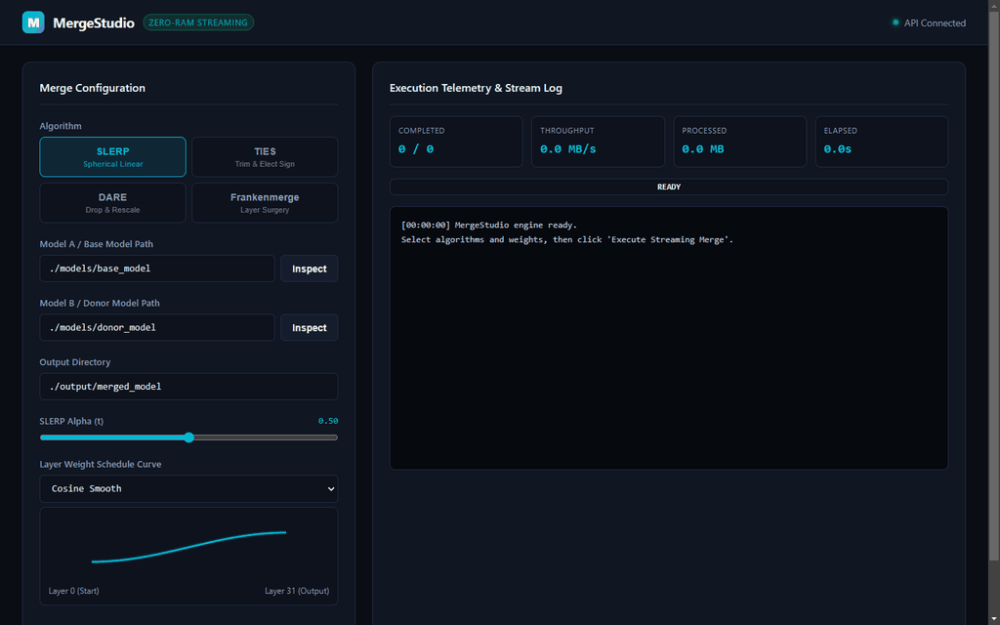

<div align="center">


# MergeStudio

**Visual model merging, layer surgery, and weight interpolation studio for local LLMs.**

[](https://pypi.org/project/mergestudio/)
[](https://opensource.org/licenses/MIT)
[](https://www.python.org/downloads/)
[](tests/)

</div>

---

MergeStudio is a toolkit for combining open weights language models without loading full parameter sets into system RAM. It provides authentic implementations of spherical linear interpolation (SLERP), TRIM-Elect Sign (TIES), Drop And Rescale (DARE), and passthrough frankenmerging.

The engine uses memory mapped `safetensors` readers and chunked streaming writers. Tensors are processed one by one on CPU or GPU buffers and written directly to disk shards, keeping memory consumption bounded by the size of an individual tensor rather than model size.



---

## Capabilities

| Algorithm | Method ID | Description | Primary Use Case |
| :--- | :--- | :--- | :--- |
| **SLERP** | `slerp` | Spherical linear interpolation preserving vector magnitudes | Merging two homologous models (e.g. Chat + Code) |
| **TIES** | `ties` | Trims lowest deltas, elects consensus signs, disjointly averages | Merging 2+ specialized fine tunes into one base |
| **DARE** | `dare_ties`, `dare_linear` | Bernoulli delta drop with unbiased rescaling factor | Absorbing multiple domain adapters with low degradation |
| **Frankenmerge** | `frankenmerge`, `passthrough` | Layer slicing, key remapping, and `config.json` surgery | Expanding layer depth or grafting reasoning modules |

---

## Studio Interface

MergeStudio includes an interactive Web Studio running on FastAPI. It provides an SVG curve editor for layer weight progression, interactive layer surgery slicing, and real time streaming telemetry over WebSockets.


To launch the studio:

```bash
mergestudio studio --host 127.0.0.1 --port 8000
```

Open `http://127.0.0.1:8000` in any browser.

---

## Installation

Install via pip:

```bash
pip install mergestudio
```

Or install from source:

```bash
git clone https://github.com/alexandrmotologa/mergestudio.git
cd mergestudio
pip install -e .
```

---

## Command Line Usage

### 1. Spherical Linear Interpolation (SLERP)

```bash
mergestudio slerp \
  --model-a ./models/llama-3-8b-instruct \
  --model-b ./models/llama-3-8b-python \
  --alpha 0.5 \
  --output ./output/llama-3-8b-merged
```

### 2. TIES Merging

```bash
mergestudio ties \
  --base ./models/llama-3-8b-base \
  --donor ./models/llama-3-8b-instruct \
  --donor ./models/llama-3-8b-code \
  --density 0.2 \
  --weight 1.0 \
  --output ./output/ties-model
```

### 3. DARE Merging

```bash
mergestudio dare \
  --base ./models/mistral-7b-v0.1 \
  --donor ./models/mistral-7b-openorca \
  --donor ./models/mistral-7b-code \
  --drop-rate 0.5 \
  --rescale \
  --output ./output/dare-model
```

### 4. Inspect Model Architecture and Safetensors

```bash
mergestudio inspect ./models/llama-3-8b-base
```

### 5. Declarative Execution from YAML

```bash
mergestudio merge --config ./configs/custom_merge.yaml
```

---

## Declarative Configuration

MergeStudio plans can be expressed in YAML or JSON:

```yaml
name: llama-3-franken-11b
method: frankenmerge
models:
  - path: ./models/meta-llama-3-8b-base
    name: llama_base
    is_base: true
  - path: ./models/meta-llama-3-8b-instruct
    name: llama_instruct
slices:
  - source_model: llama_base
    start_layer: 0
    end_layer: 16
  - source_model: llama_instruct
    start_layer: 8
    end_layer: 24
  - source_model: llama_base
    start_layer: 16
    end_layer: 32
streaming_config:
  output_dtype: float16
  shard_size_gb: 4.9
output_dir: ./output/llama-3-11b-merged
```

---

## Python API

```python
import torch
from mergestudio.algorithms import slerp, ties_merge, dare_merge
from mergestudio.streaming import StreamingMergeEngine
from mergestudio.core import MergePlan, ModelSource, SlerpConfig, MergeMethod

# Direct mathematical tensor interpolation
v0 = torch.randn(4096, 4096)
v1 = torch.randn(4096, 4096)
merged_tensor = slerp(v0, v1, alpha=0.4, preserve_norm=True)

# Zero-RAM streaming execution
plan = MergePlan(
    name="my-merge",
    method=MergeMethod.SLERP,
    models=[
        ModelSource(path="./model_a", name="a"),
        ModelSource(path="./model_b", name="b"),
    ],
    slerp_config=SlerpConfig(alpha=0.5),
    output_dir="./output/merged",
)

engine = StreamingMergeEngine(plan)
engine.run(progress_callback=lambda p: print(f"Progress: {p.completed_tensors}/{p.total_tensors}"))
```

---

## Architecture & Zero-RAM Streaming

Standard model merging frameworks load multiple model weights into CPU RAM simultaneously. Merging three 8B models in float16 requires over 48 GB of system RAM, causing crashes on standard workstations.

MergeStudio bypasses this with memory mapped file descriptors:
1. `ModelIndex` scans safetensors metadata and locates each tensor across shards without reading tensor data.
2. The pipeline iterates over each target parameter key.
3. Only the specific tensor is read from the input safetensors files into memory.
4. The algorithm merges the tensor on CPU or GPU.
5. The result is buffered in the sharded writer and released immediately to the garbage collector.
6. The process runs with a memory footprint under 200 MB regardless of overall model size.

---

## Running Tests

Run the test suite with pytest:

```bash
pytest --cov=mergestudio --cov-report=term-missing tests/
```

---

## License

MIT License. See [LICENSE](LICENSE) for details.
